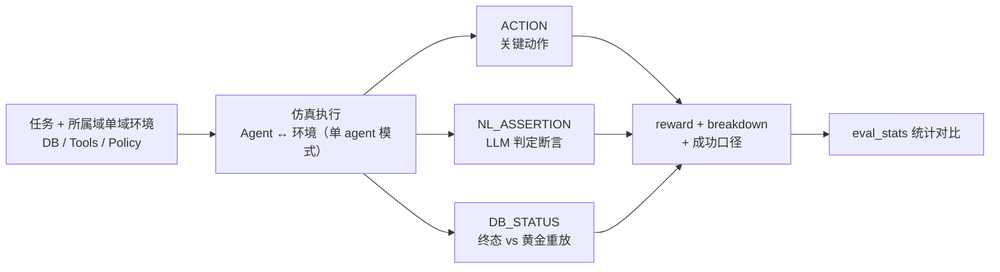

# OfficePrism

面向办公场景的 LLM Agent 评测基准（KDD 2027）。

OfficePrism 在模拟的企业办公环境中评测 Agent 完成真实业务任务的能力：Agent 需要理解用户诉求、追问缺失信息、调用业务工具读写数据库，并把结果清楚地传达给用户。评测不仅看"答没答对"，更看"做没做对"——以数据库终态为核心完成判据，输出可解释的多维得分。

## 亮点

- **7 个业务域、420 条任务**：人事（hr）、财务（finance）、行政（admin）、信息技术（it）、法务（law）、采购（purchase）、综合办公（work），难度分 L1 / L2 / L3 三档。
- **完整的模拟办公环境**：每个域拥有结构化业务数据库、读/写工具集与业务规则（Policy），跨表引用一致、状态机完整；默认以单 agent 仿真执行（solo 模式：agent 亦可调用用户侧工具）。
- **过程 + 结果双轨判分**：ACTION（关键工具调用）、NL_ASSERTION（自然语言断言，LLM 判定）、DB_STATUS（数据库终态与黄金参照重放对比），失败原因可定位、可分桶。
- **开箱即用**：内置 3 种 Agent 实现，一条命令跑通评测；同时提供多种外部 Agent 基线适配器，模型可任意切换（OpenAI 兼容端点）。

## 评测集：task_v1

评测集位于 `data/tasks_eval/task_v1.json`，共 420 条任务：

| 域 | 条数 | | 难度 | 条数 |
|---|---|---|---|---|
| hr | 60 | | L1 | 105 |
| finance | 58 | | L2 | 140 |
| admin | 56 | | L3 | 175 |
| it | 60 | | | |
| law | 76 | | | |
| purchase | 55 | | | |
| work | 55 | | | |

每条任务的字段：

| 字段 | 说明 |
|---|---|
| `task_id` | 任务唯一标识（如 `l1_56a218f4`） |
| `level` / `domain` | 难度档（L1/L2/L3）与所属业务域 |
| `business_scenario` | 业务场景背景 |
| `question` | 用户任务指令 |
| `caller` | 发起人身份与已知信息 |
| `tool_chain` | 黄金参照工具链（参考解法，判分不要求逐字复现） |
| `expected_answer` | 参考答案 |
| `metadata` | 工具/表子集与分组信息（`tool_subset`、`table_subset`、`group`） |
| `verified` | 任务可解性校验标记 |

环境与数据均为合成构建，不含任何真实企业或个人数据。

每条任务归属单一业务域。默认评测入口 `cross` 加载全部 420 条任务，并把每条任务路由到其所属域的单域环境执行（数据库、工具池与业务规则均为本域）；`--domain hr` 等入口只运行指定域环境。跨域合并工具池仅用于 `--pool-domains` 的 tool-scaling 实验，非默认行为。

## 判分口径

仿真结束后，评测器输出 `reward` 与分维度 `breakdown`：

- **ACTION**：关键工具调用是否发生、参数是否正确（过程约束）。
- **NL_ASSERTION**：任务声明的自然语言断言是否成立，由 LLM 裁判判定（语义/沟通质量）。
- **DB_STATUS**：在干净数据库上重放黄金工具链得到参照终态，与 Agent 执行后的数据库终态对比。结构化字段做精确比对（结构分），自由文本字段由 LLM 判定语义等价（文案分），两者相乘得 1.0 / 0。

`reward` 按任务声明的 `reward_basis` 聚合：写操作任务为 ACTION + NL_ASSERTION，只读/跨域任务以 NL_ASSERTION 为依据；DB_STATUS 独立输出。结果文件中提供四种成功口径：

| 口径 | 定义 |
|---|---|
| `strict_success` | `reward > 0.5` |
| `success` | 只读任务按 NL_ASSERTION > 0.5（答案优先）；写操作任务同 strict |
| `success_w_db` | `success` 且 `DB_STATUS ≥ 1.0` |
| `strict_success_w_db` | `strict_success` 且 `DB_STATUS ≥ 1.0`（过程与终态双达标） |

## 安装

要求 Python 3.10+。

```bash
pip install -r requirements.txt
# 如需运行外部 Agent 基线，另装：
pip install -r requirements-external.txt
```

配置模型与密钥：编辑 `configs/app.yaml` 中 `evaluation.llm.agent` 段：

```yaml
agent:
  model: "qwen4-max"          # 任意 OpenAI 兼容端点上的模型名
  api_key: YOUR_DASHSCOPE_API_KEY   # 替换为你的 API key
  base_url: https://dashscope.aliyuncs.com/compatible-mode/v1
```

- 默认指向 DashScope 的 OpenAI 兼容端点，可改为任何兼容服务；
- LLM 裁判（评测器）模型同样在 `app.yaml` 中配置；
- 支持 `.env` 文件（启动时自动加载），也可用命令行 `--api-key / --base-url / --model` 临时覆盖。

## 快速开始

```bash
# 冒烟试跑：第一条任务 × 启用的 agent
./eval.sh --dry-run

# 全量评测：420 条任务 × 启用的 agent（默认 cross 入口 + react_agent）
./eval.sh
```

等价的手动命令：

```bash
# 单 agent 评测（cross 入口：每条任务路由到所属域的单域环境）
python -m bench.run_domain_eval \
    --domain cross \
    --task-path data/tasks_eval/task_v1.json \
    --agent react_agent \
    --max-steps 50 \
    --save-to data/results/cross/task_v1_react_agent_qwen4-max.json

# 多 agent × 多模型批量评测
python -m bench.run_benchmark \
    --domain cross \
    --agents react_agent fc_agent plan_execute_agent \
    --models qwen4-max \
    --task-path data/tasks_eval/task_v1.json

# 结果统计与对比
python -m bench.eval_stats --result-path data/results/cross/task_v1_react_agent_qwen4-max.json
python -m bench.eval_stats --pattern "data/results/cross/*.json"
```

结果写入 `data/results/{domain}/`，每条记录包含 reward、分维度 breakdown、四种成功口径、完整对话与工具调用轨迹、token 用量。

## 支持的 Agent

**内置（开箱即用）**：`react_agent`、`fc_agent`（function-calling）、`plan_execute_agent`。

**外部基线（需先自行部署对应服务）**：AutoGen 系列（code_action / llmcompiler / reflexion / supervisor / swarm / debate / round_robin / moa）、OpenClaw、Claude Code、Hermes、DeerFlow、AgentZero 等。启用方式见 `eval.sh` 中的注释列表，依赖见 `requirements-external.txt`，各适配器的服务地址与认证在 `configs/app.yaml` 中配置。

## 评测流程



## 目录结构

```
OfficePrism/
├── bench/
│   ├── agent/               # 内置 agent 与外部适配器（external/）
│   ├── data_model/          # 任务/消息/断言等数据模型
│   ├── domains/             # 各域工具实现与环境逻辑
│   ├── environment/         # 通用环境（DB 执行、序列化）
│   ├── evaluator/           # 多维评测器（ACTION/DB/NL）
│   ├── run_domain_eval.py   # 单 agent 评测入口
│   ├── run_benchmark.py     # 多 agent × 多模型批量入口
│   └── eval_stats.py        # 结果统计
├── configs/
│   ├── app.yaml             # 模型/密钥/仿真参数配置
│   └── config_loader.py
├── data/
│   ├── domains/             # 各域数据库与规则（base 为共享底座）
│   ├── tasks_eval/task_v1.json
│   └── user_simulator/      # 模拟用户行为准则
├── eval.sh                  # 一键评测脚本
├── requirements.txt
└── requirements-external.txt
```

## 扩展新业务域

评测框架与业务域解耦，新增域遵循最小改动原则：

- 复用 `data/domains/base` 的组织/人员/权限底座，只增量添加域数据与工具；
- 在 `bench/domains/` 下实现域工具与环境，注册域名；
- 任务与判分差异通过任务 JSON 和断言表达，评测器无需修改。

## 引用

论文发表于 KDD 2027，引用信息将在论文正式出版后更新：

```bibtex
@inproceedings{officeprism2027,
  title     = {OfficePrism},
  booktitle = {Proceedings of the ACM SIGKDD Conference on Knowledge Discovery and Data Mining (KDD)},
  year      = {2027}
}
```

## 许可证

[Apache License 2.0](LICENSE)