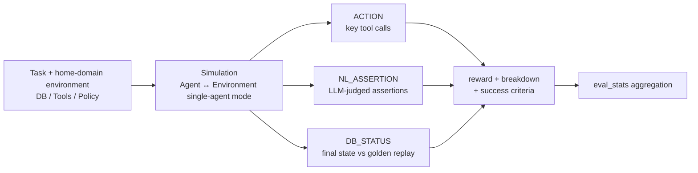

# OfficePrism

**Benchmarking Agents on Single-Domain Operations Across Enterprise Business Functions** (KDD 2027)

Paper: [arXiv:2611.22262](https://arxiv.org/abs/2611.22262)

OfficePrism evaluates LLM agents' ability to complete realistic business tasks in a simulated enterprise office environment: the agent must understand user requests, ask for missing information, invoke business tools to read and write databases, and communicate results clearly. Beyond "did it answer correctly", OfficePrism measures "did it actually get the job done" — the final database state is the core completion criterion, and scoring is multi-dimensional and interpretable.

## Highlights

- **7 business domains, 420 tasks**: Human Resources (hr), Finance (finance), Administration (admin), IT (it), Legal (law), Procurement (purchase), and General Office (work), across three difficulty tiers L1 / L2 / L3.
- **Complete simulated office environment**: each domain ships a structured business database, a read/write toolset, and business policies, with consistent cross-table references and complete state machines. Tasks run in single-agent simulation (solo mode: the agent may also invoke user-side tools).
- **Process + outcome dual-track scoring**: ACTION (key tool calls), NL_ASSERTION (natural-language assertions judged by an LLM), and DB_STATUS (final database state compared against a golden reference replay). Failures can be localized and bucketed by cause.
- **Out of the box**: 3 built-in agent implementations, one command to run the full evaluation; adapters for external agent baselines; any model reachable through an OpenAI-compatible endpoint.

## Evaluation Set: task_v1

The evaluation set lives at `data/tasks_eval/task_v1.json` and contains 420 tasks:

| Domain | Tasks | | Level | Tasks |
|---|---|---|---|---|
| hr | 60 | | L1 | 105 |
| finance | 58 | | L2 | 140 |
| admin | 56 | | L3 | 175 |
| it | 60 | | | |
| law | 76 | | | |
| purchase | 55 | | | |
| work | 55 | | | |

Task fields:

| Field | Description |
|---|---|
| `task_id` | Unique task identifier (e.g. `l1_56a218f4`) |
| `level` / `domain` | Difficulty tier (L1/L2/L3) and home business domain |
| `business_scenario` | Business scenario background |
| `question` | User task instruction |
| `caller` | Requester identity and known information |
| `tool_chain` | Golden reference tool chain (a reference solution; scoring does not require verbatim reproduction) |
| `expected_answer` | Reference answer |
| `metadata` | Tool/table subsets and grouping (`tool_subset`, `table_subset`, `group`) |
| `verified` | Task solvability verification flag |

Each task belongs to a single business domain. The default entry `cross` loads all 420 tasks and routes each task to its home-domain environment (database, tool pool, and policies are all domain-local); entries such as `--domain hr` run only the specified domain. A merged cross-domain tool pool is available only via `--pool-domains` for tool-scaling experiments — it is not the default behavior.

All environments and data are synthetically constructed; no real enterprise or personal data is included.

## Scoring

After each simulation, the evaluator outputs a `reward` and a per-dimension `breakdown`:

- **ACTION**: whether the key tool calls occurred with correct arguments (process constraint).
- **NL_ASSERTION**: whether the task's natural-language assertions hold, judged by an LLM (semantic / communication quality).
- **DB_STATUS**: the golden tool chain is replayed on a clean database to obtain a reference final state, which is compared against the database state after the agent's run. Structured fields are compared exactly (structural score); free-text fields are judged for semantic equivalence by an LLM (textual score). The two are multiplied into a 1.0 / 0 verdict.

`reward` is aggregated according to the task's declared `reward_basis`: write tasks use ACTION + NL_ASSERTION, while read-only tasks use NL_ASSERTION; DB_STATUS is reported separately. Result files provide four success criteria:

| Criterion | Definition |
|---|---|
| `strict_success` | `reward > 0.5` |
| `success` | Read-only tasks: NL_ASSERTION > 0.5 (answer-first); write tasks: same as strict |
| `success_w_db` | `success` and `DB_STATUS ≥ 1.0` |
| `strict_success_w_db` | `strict_success` and `DB_STATUS ≥ 1.0` (both process and final state correct) |

## Installation

Requires Python 3.10+.

```bash
pip install -r requirements.txt
# Optional, for external agent baselines:
pip install -r requirements-external.txt
```

Configure the model and API key in the `evaluation.llm.agent` section of `configs/app.yaml`:

```yaml
agent:
  model: "qwen4-max"          # any model name on an OpenAI-compatible endpoint
  api_key: YOUR_DASHSCOPE_API_KEY   # replace with your API key
  base_url: https://dashscope.aliyuncs.com/compatible-mode/v1
```

- The default points to DashScope's OpenAI-compatible endpoint; any compatible service works.
- The LLM judge (evaluator) model is configured in `app.yaml` as well.
- `.env` files are supported (loaded automatically at startup); `--api-key / --base-url / --model` provide one-off CLI overrides.

## Quick Start

```bash
# Smoke test: first task × enabled agents
./eval.sh --dry-run

# Full evaluation: 420 tasks × enabled agents (default: cross entry + react_agent)
./eval.sh
```

Equivalent manual commands:

```bash
# Single-agent evaluation (cross entry: each task is routed to its home-domain environment)
python -m bench.run_domain_eval \
    --domain cross \
    --task-path data/tasks_eval/task_v1.json \
    --agent react_agent \
    --max-steps 50 \
    --save-to data/results/cross/task_v1_react_agent_qwen4-max.json

# Multi-agent × multi-model batch evaluation
python -m bench.run_benchmark \
    --domain cross \
    --agents react_agent fc_agent plan_execute_agent \
    --models qwen4-max \
    --task-path data/tasks_eval/task_v1.json

# Statistics and comparison
python -m bench.eval_stats --result-path data/results/cross/task_v1_react_agent_qwen4-max.json
python -m bench.eval_stats --pattern "data/results/cross/*.json"
```

Results are written to `data/results/{domain}/`. Each record contains the reward, per-dimension breakdown, the four success criteria, the full conversation and tool-call trajectory, and token usage.

## Supported Agents

**Built-in (out of the box)**: `react_agent`, `fc_agent` (function-calling), `plan_execute_agent`.

**External baselines (require self-hosting the corresponding service)**: the AutoGen family (code_action / llmcompiler / reflexion / supervisor / swarm / debate / round_robin / moa), OpenClaw, Claude Code, Hermes, DeerFlow, AgentZero, and more. See the commented list in `eval.sh` for how to enable them, `requirements-external.txt` for dependencies, and `configs/app.yaml` for service endpoints and credentials.

## Evaluation Pipeline



## Repository Structure

```
OfficePrism/
├── bench/
│   ├── agent/               # Built-in agents and external adapters (external/)
│   ├── data_model/          # Task / message / assertion data models
│   ├── domains/             # Per-domain tool implementations and environment logic
│   ├── environment/         # Generic environment (DB execution, serialization)
│   ├── evaluator/           # Multi-dimensional evaluators (ACTION/DB/NL)
│   ├── run_domain_eval.py   # Single-agent evaluation entry
│   ├── run_benchmark.py     # Multi-agent × multi-model batch entry
│   └── eval_stats.py        # Result statistics
├── configs/
│   ├── app.yaml             # Model / credential / simulation configuration
│   └── config_loader.py
├── data/
│   ├── domains/             # Per-domain databases and policies (base = shared foundation)
│   ├── tasks_eval/task_v1.json
│   └── user_simulator/      # Simulated-user behavior guidelines
├── eval.sh                  # One-command evaluation script
├── requirements.txt
└── requirements-external.txt
```

## Extending to New Domains

The evaluation framework is decoupled from business domains. Adding a domain follows a minimal-change principle:

- Reuse the organization / personnel / permission foundation in `data/domains/base`; add only domain-incremental data and tools.
- Implement domain tools and environment under `bench/domains/` and register the domain name.
- Express task and scoring differences through task JSON and assertions; the evaluator needs no changes.

## Citation

If you find OfficePrism useful in your research, please cite:

```bibtex
@misc{liu2026officeprismbenchmarkingagentssingledomain,
      title={OfficePrism: Benchmarking Agents on Single-Domain Operations Across Enterprise Business Functions},
      author={Hanfeng Liu and Zhenyu Luo and Dongchao Zhang and Zexi Liu and Zulong Chen and Jinxin Hu and Jia Xu and Zeyi Wen},
      year={2026},
      eprint={2611.22262},
      archivePrefix={arXiv},
      primaryClass={cs.CL},
      url={https://arxiv.org/abs/2611.22262},
}
```

## License

[Apache License 2.0](LICENSE)